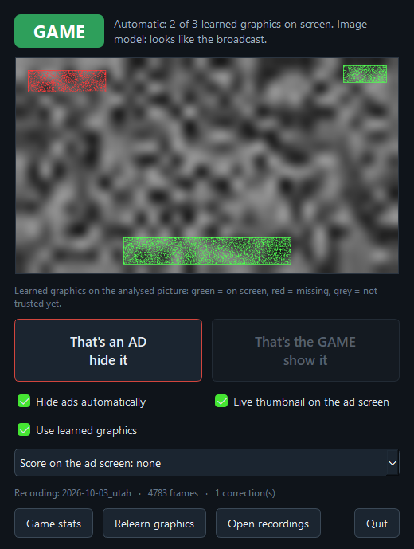
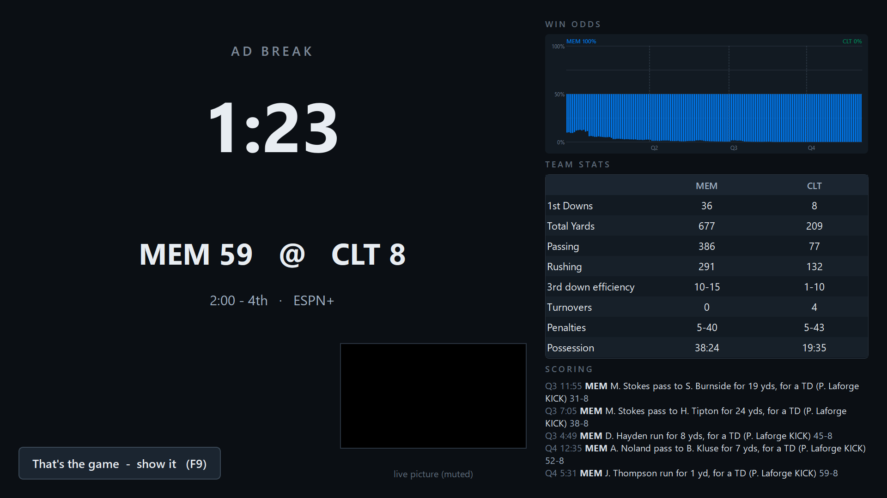

# Football Ad Blocker

A companion app for watching college football in **Chrome on Windows** (YouTube TV, Fubo, or any
service that plays in a Chrome window). When an ad break starts it **mutes Chrome and covers the
stream with a stats screen** - the score, win odds after every play, team stats, the scoring
summary - and when the game comes back it gets out of the way. It never touches the stream: it
only looks at what is on screen, so it costs nothing in picture quality or latency and works with
whatever is playing in that window.

<p align="center">
  
  &nbsp;&nbsp;
  
</p>

It hides ads **by itself**. An image model looks at the whole picture once a second and decides
"broadcast" or "commercial"; the broadcast's own fixed graphics (the scorebug, the network's corner
logo), learned while you watch and remembered between sessions, guard it. When it is wrong you tell
it with one click, and every correction is recorded as a label next to low-res frames of the stream
- the data the next, better detector is trained and measured on.

It was built and tuned on one PC over a few game days (FOX and ABC/ESPN on YouTube TV, FOX on
Fubo). [PLAN.md](PLAN.md) is the engineering log with every measurement and every reason. Treat it
as a working prototype that is useful today, not a finished product.

## How it decides

| Signal | What it does | How fast |
| --- | --- | --- |
| **Image model** (CLIP, zero-shot, no training; `requirements-ml.txt`) | Looks at the whole picture once a second: does this look like the broadcast or like a commercial? Its three-second verdict saying "commercial" for 4 s hides; "broadcast" for 3 s shows; 2 s after a cut to black. | ad screen up 5-7 s into a break; game back 4-5 s into the return |
| **Learned graphics** (scorebug, corner logo; found by itself, no templates) | Guard rails: while one is on screen nothing is hidden - a replay or a full-screen stat graphic is never mistaken for an ad - and when one comes back the picture is back at once. | under a second on a return |
| **You** | "That's the game" on the ad screen, "That's an AD" / "That's the GAME" in the window or tray, or **F9**. Takes effect at once, is held until the picture agrees, and is logged as a label. | immediate |

Untick **Use learned graphics** in the window and the image model decides alone. Without the
image model installed, the learned graphics drive on their own (5 s without any → hidden, one
back → shown), which was enough on FOX, whose corner logo never leaves during live coverage, but
not on ABC/ESPN, whose logo does. The rules, their timings and the recorded moments behind them
are in [docs/how-it-works.md](docs/how-it-works.md).

## Requirements

- **Windows 11** (Windows 10 version 2004 or later should work - the app needs Windows Graphics
  Capture and capture-excluded windows - but is untested). One or two monitors.
- **Google Chrome** playing the stream, windowed or fullscreen. Tested with YouTube TV and Fubo;
  another service only needs its window title added to a setting. Tested with Chrome's *Use
  graphics acceleration when available* **switched off**; with it on, DRM-protected video may
  capture as black frames - untested, and the first thing to check if the window's live view stays black.
- **Python 3.11** (what it is developed and pinned with).
- For the image model, strongly recommended: an **NVIDIA GPU** with a current driver (the pinned
  PyTorch build is CUDA 12.6; the model uses about 1 GB of VRAM and ~10 ms per frame). It runs on
  the CPU too, more slowly. About 5 GB of disk in the virtual environment plus ~600 MB of model
  weights downloaded from Hugging Face on the first start.

## Install

```powershell
git clone <this repository> FootballAdBlocker
cd FootballAdBlocker
py -3.11 -m venv .venv
.\.venv\Scripts\python.exe -m pip install -r requirements.txt
.\.venv\Scripts\python.exe -m pip install -r requirements-ml.txt   # the image model: optional, strongly recommended
.\.venv\Scripts\python.exe tools\install_shortcuts.py              # "Football Ad Blocker" on the Desktop and in the Start menu
```

`requirements-ml.txt` pins a CUDA 12.6 build of PyTorch; for another GPU, driver or a machine
without an NVIDIA card, install the matching build from [pytorch.org](https://pytorch.org/get-started/locally/)
first (the comments in that file say how). The app finds whatever is installed.

## Use

Start the stream in Chrome, then start **Football Ad Blocker** from the shortcut (or
`start_ui.cmd`; `.\run.cmd` does the same with the log in a console). A small **control window**
opens on the screen the game is *not* on, and a **tray icon** appears: green dot = GAME, red = AD.
**Closing the window quits the app** and always leaves Chrome unmuted; so do *Quit* in the tray
menu and **Ctrl+Shift+F9**. Minimize it to get it out of the way while it works.

| When | What to do |
| --- | --- |
| It covered live play | Click **"That's the game - show it"** on the ad screen itself (or the button in the window / tray menu, or **F9**) |
| An ad is showing | **"That's an AD - hide it"** in the window or tray menu, or **F9** |
| It seems confused about this broadcast | **Relearn graphics** in the window |
| You'd rather trust the image model alone | Untick **Use learned graphics** (`graphics = false` in `config.toml` makes that the default) |
| You'd rather toggle by hand | Untick **Hide ads automatically**: the detector keeps watching and logging, F9 toggles |
| You want the numbers | **Game stats** in the window or the tray menu: win odds after every play, both teams side by side or one team's own stats and players, the scoring summary and the last plays |

Pick the game in the window (remembered next time) and the ad screen shows its score, 45 s behind
the feed on purpose so it never spoils a play; the stats screen on its right is held back the same
way. In a small Chrome window only the timer, score and thumbnail fit.

What to expect:

- **No training per game.** The broadcast's graphics are found by themselves in the first minute
  or two of play and remembered (`learned/graphics.npz`), so a network you have watched before is
  recognised in the first second. Until something is learned, only the image model can hide.
- **Ads are covered about 5-7 s after a break starts**, deliberately. The game is back within a
  second of a learned graphic returning, 4-5 s after the picture starts looking like the broadcast
  again (the return bumper), or 2 s after a cut to black followed by the broadcast.
- **The network's corner logo means "game".** A halftime studio show that carries it stays
  visible; one that does not (FOX's, mostly) is told from its commercials by the image model.
- **Ads that look like football** - a stadium-set spot, a promo made of highlights - are the known
  weakness: they show for a few seconds until the model changes its mind. Leaking a few ad seconds
  is the cheap mistake; hiding live play is the expensive one, and the whole design leans that way.
- **A correction is held until the picture agrees with it**, then automatic detection carries
  on. Clicking a few seconds early or late needs no second click.
- If it can't see the stream (another tab, minimized, a window size it hasn't learned yet) it
  shows the game rather than guess. Leaving or entering fullscreen means learning the graphics
  again for that window size; remembered graphics apply to fullscreen only.
- The ad screen steps aside when another app's window is actually *in front of* the stream.
- Switching channels or services needs no restart; the graphics are learned afresh.

Settings live in `config.toml` (copy `config.example.toml`) or on the command line: every one of
them, with its default, is in [docs/configuration.md](docs/configuration.md). When something is
off, [docs/troubleshooting.md](docs/troubleshooting.md) goes symptom by symptom. The app's log is
`logs\app.log`.

## Recording and privacy

Every session is recorded to `sessions/<date>_<label>/` (git-ignored, never uploaded): 640-pixel
JPEG frames of the stream at ~4 fps (about 1.5 GB for a 3.5-hour game; `--fps 2` halves it,
`record = false` turns it off), a timeline of every state change and click, and the detector's
evidence per frame. Recording pauses whenever the Chrome window shows a tab that is not the stream.
This is what makes the tool improvable: the recordings replay through the live detector code, so
any change is measured against every game watched before it touches a live one
([docs/development.md](docs/development.md)).

The app talks to exactly two places on the network: ESPN's public scoreboard and summary API (no
key, read-only) for the score and stats, and Hugging Face once, to fetch the image model's weights.
Nothing about what you watch leaves the machine.

## Limits

- College football only, as far as the score and stats go (ESPN's college endpoints). The
  detection itself does not care about the league, but the image model's prompts say "football".
- One Chrome window, one stream at a time; no multiview.
- The stream delay is a fixed setting (45 s), not measured from the picture.
- The ad screen is excluded from screen capture by design, so no screenshot can show it;
  `tools\preview_overlay.py` renders it to a file instead.
- Needs a game-like picture to learn from: a broadcast watched for the first time hides nothing
  in its first minute unless the image model is installed.

## Development

```powershell
.\.venv\Scripts\python.exe -m unittest discover -s tests -t .      # unit tests: no screen, no Chrome, no GPU needed
.\.venv\Scripts\python.exe tools\evaluate.py --scene --drive --sheet   # replay recorded games through the live detector
.\.venv\Scripts\python.exe tools\preview_control_window.py           # render the control window to a PNG
```

[docs/development.md](docs/development.md) covers the code layout, the recording format and its
labels, the evaluator and the other tools, and how to add a streaming service or adapt the detector;
[CONTRIBUTING.md](CONTRIBUTING.md) says how changes are measured before they are merged.
[PLAN.md](PLAN.md) is the design and the log of what every live game taught.

## License

[MIT](LICENSE).
